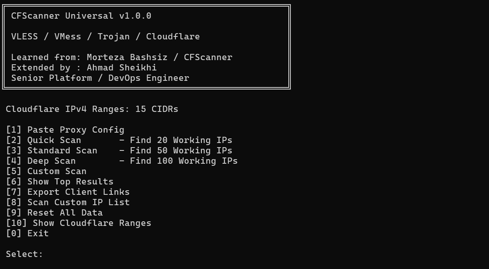
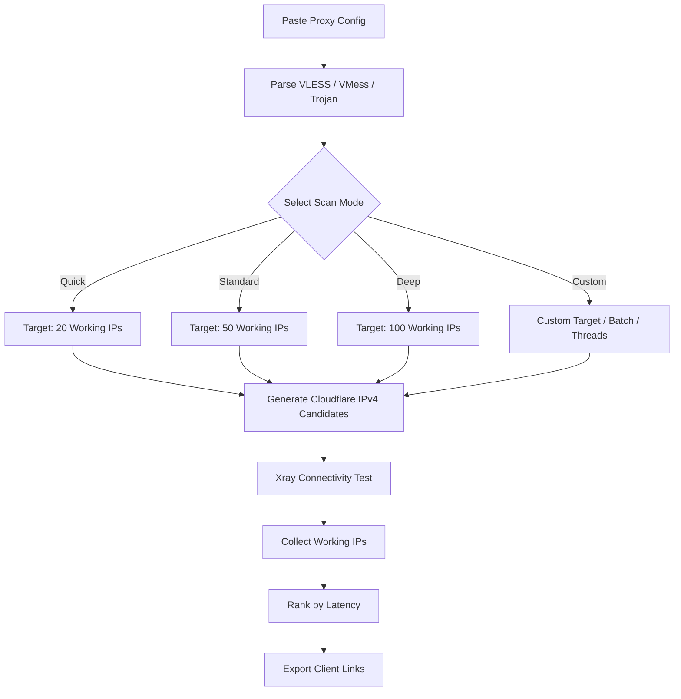

<p align="center">
  
</p>

<h1 align="center">CFScanner Universal</h1>

<p align="center">
  Portable Docker-based Cloudflare IP scanner for
  <b>VLESS</b>, <b>VMess</b>, and <b>Trojan</b>.
</p>

<p align="center">
  <a href="https://hub.docker.com/r/ahmadsheikhi/cfscanner">
    
  </a>
  <a href="https://hub.docker.com/r/ahmadsheikhi/cfscanner">
    
  </a>
  <a href="https://github.com/ahmadsheikhi89/CFscanner-universal/tags">
    
  </a>
</p>

<p align="center">
  
  
  
  
  
</p>

---

## Overview

**CFScanner Universal** is a portable Docker-based scanner for discovering working Cloudflare IPs using existing **VLESS**, **VMess**, or **Trojan** configurations.

Paste a proxy share link, select a scan mode, and the scanner will:

- Generate candidates from bundled Cloudflare IPv4 ranges
- Test connectivity through the supplied proxy configuration
- Discover working IPs
- Rank results by latency
- Persist scan state
- Export ready-to-import client links

---

## Quick Start

Run the latest version:

```bash
docker run --rm -it \
  -v cfscanner-data:/data \
  ahmadsheikhi/cfscanner:latest
```

Run the stable `1.0.0` release:

```bash
docker run --rm -it \
  -v cfscanner-data:/data \
  ahmadsheikhi/cfscanner:1.0.0
```

Docker Hub:

https://hub.docker.com/r/ahmadsheikhi/cfscanner

---

## Features

- Interactive CLI menu
- VLESS configuration parsing
- VMess configuration parsing
- Trojan configuration parsing
- Cloudflare IPv4 range scanning
- Quick / Standard / Deep scan profiles
- Custom scan mode
- Custom IP list support
- Persistent scan state
- Duplicate candidate avoidance
- Latency-based result ranking
- Client-ready proxy link export
- Docker volume persistence
- Built-in Cloudflare CIDR list
- Full local data reset

---

## How It Works



---

## Interactive CLI

```text
╔════════════════════════════════════════════════════╗
║ CFScanner Universal                                ║
║                                                    ║
║ VLESS / VMess / Trojan / Cloudflare                ║
║                                                    ║
║ Learned from: Morteza Bashsiz / CFScanner          ║
║ Extended by : Ahmad Sheikhi                        ║
║ Senior Platform / DevOps Engineer                  ║
╚════════════════════════════════════════════════════╝

 Cloudflare IPv4 Ranges: 15 CIDRs

 [1] Paste Proxy Config
 [2] Quick Scan       - Find 20 Working IPs
 [3] Standard Scan    - Find 50 Working IPs
 [4] Deep Scan        - Find 100 Working IPs
 [5] Custom Scan
 [6] Show Top Results
 [7] Export Client Links
 [8] Scan Custom IP List
 [9] Reset All Data
 [10] Show Cloudflare Ranges
 [0] Exit
```

---

## Scan Modes

| Mode | Target | Default Batch |
|---|---:|---:|
| Quick | 20 working IPs | 50 |
| Standard | 50 working IPs | 100 |
| Deep | 100 working IPs | 200 |
| Custom | User defined | User defined |

Batch size is reduced automatically when the scan approaches its target to avoid unnecessary scanning.

---

## Supported Proxy Configs

Paste a standard proxy share link directly into the CLI:

```text
vless://...
vmess://...
trojan://...
```

Supported transports include:

```text
ws
grpc
xhttp
```

---

## Cloudflare IPv4 Ranges

The image includes the Cloudflare IPv4 CIDRs used for candidate generation.

Current bundled list:

```text
173.245.48.0/20
103.21.244.0/22
103.22.200.0/22
103.31.4.0/22
141.101.64.0/18
108.162.192.0/18
190.93.240.0/20
188.114.96.0/20
197.234.240.0/22
198.41.128.0/17
162.158.0.0/15
104.16.0.0/13
104.24.0.0/14
172.64.0.0/13
131.0.72.0/22
```

The list can also be displayed from the application:

```text
[10] Show Cloudflare Ranges
```

Source file:

```text
assets/cf.local.iplist
```

---

## Persistent Data

Runtime state is stored under:

```text
/data
```

The recommended Docker volume:

```bash
-v cfscanner-data:/data
```

keeps configuration, scan state, and results between container runs.

To remove all saved state:

```text
[9] Reset All Data
```

---

## Output Files

Quick Scan example:

```text
/data/top20.txt
/data/top20-ranked.txt
/data/top20-links.txt
```

Standard Scan example:

```text
/data/top50.txt
/data/top50-ranked.txt
/data/top50-links.txt
```

Deep Scan example:

```text
/data/top100.txt
/data/top100-ranked.txt
/data/top100-links.txt
```

### Result Types

`top20.txt`

```text
104.24.x.x
104.16.x.x
104.27.x.x
```

`top20-ranked.txt`

```text
1051 104.24.x.x
1076 104.16.x.x
1092 104.27.x.x
```

`top20-links.txt`

Contains ready-to-import VLESS / VMess / Trojan client links using the discovered Cloudflare IPs.

---

## Docker Images

Latest stable:

```text
ahmadsheikhi/cfscanner:latest
```

Versioned release:

```text
ahmadsheikhi/cfscanner:1.0.0
```

Pull manually:

```bash
docker pull ahmadsheikhi/cfscanner:latest
```

---

## Repository Structure

```text
.
├── assets/
│   ├── banner.png
│   └── cf.local.iplist
├── configuration/
├── docker/
│   └── entrypoint.sh
├── logger/
├── scanner/
├── speedtest/
├── tui/
├── utils/
├── vpn/
├── Dockerfile
├── go.mod
├── go.sum
└── README.md
```

---

## Build From Source

```bash
git clone https://github.com/ahmadsheikhi89/CFscanner-universal.git

cd CFscanner-universal

docker build \
  -t cfscanner-local \
  .
```

Run:

```bash
docker run --rm -it \
  -v cfscanner-data:/data \
  cfscanner-local
```

---

## Acknowledgments

This project builds on the work and experience of the open-source community.

The current scanner engine is derived from:

**ArchNets / CDN-IP-Scanner**

I originally learned the Cloudflare IP scanning approach from:

**Morteza Bashsiz / CFScanner**

CFScanner Universal extends that experience with:

- Portable Docker deployment
- Interactive proxy configuration
- VLESS / VMess / Trojan support
- Automated Cloudflare candidate generation
- Batch scanning
- Persistent scan state
- Latency-based ranking
- Client-ready proxy link export

---

## Maintainer

**Ahmad Sheikhi**  
Senior Platform / DevOps Engineer

GitHub:

https://github.com/ahmadsheikhi89

Docker Hub:

https://hub.docker.com/u/ahmadsheikhi

---

## Disclaimer

Use this software only on networks and services you are authorized to test.

Users are responsible for complying with applicable laws, service terms, and network policies.
